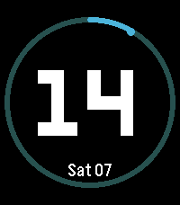
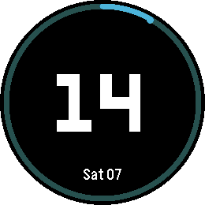

# Tide

*A big hour, a sweeping minute arc and the date, in your colours.*

 

A Pebble watchface (v1.0.0) for Pebble Time 2 (emery) and Pebble Round 2 (gabbro).

Tide shows the hour as a large number in the centre of the screen. The minutes
run as a progress arc around the edge, with a soft track and a marker at the
current minute. The date sits at the bottom.

## Features

- Large hour number, centred both ways.
- Minute progress arc with a bright marker.
- Small date below.
- 12 or 24 hour format follows the watch setting.
- Three colour settings, applied live from the phone.

## Settings

- **Background** - the face colour.
- **Hour and date** - the colour of the hour and the date.
- **Accent colour** - the colour of the minute arc and its marker.

## Building

Requires the [Pebble SDK](https://developer.repebble.com/sdk/).

```bash
pebble build
pebble install --emulator gabbro
```

## Release notes

### 1.0.0

First release.

## Status

- v1.0.0: Hour, minute arc, date and accent colour implemented for emery and
  gabbro.
- Store copy, three screenshot presets and icons are in place.
- Open: publish to the Rebble App Store.

## License

MIT, see [LICENSE](LICENSE).
